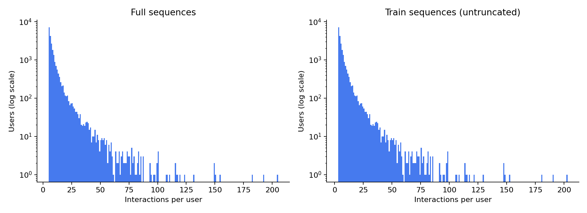
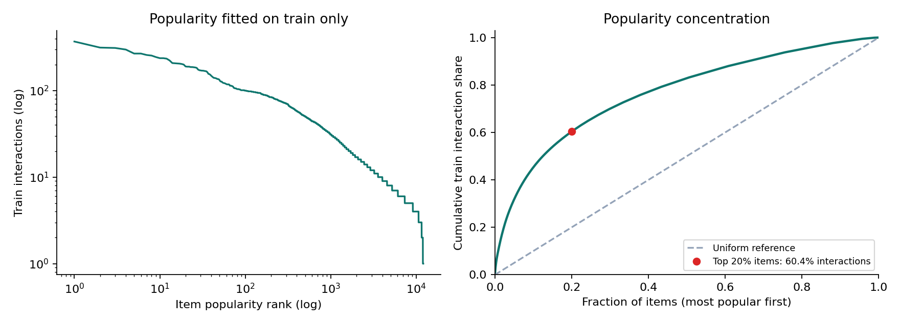

# EDA Beauty 2014 — Tuần 1 của B

Phạm vi: độ dài chuỗi, long-tail, độ thưa, tình trạng thiếu metadata và ví dụ mô tả sản phẩm.

Nhận xét nối kết quả quan sát với hệ quả có thể xảy ra; ảnh hưởng đến mô hình cần được kiểm chứng bằng thí nghiệm.

Run: eda_beauty_5core; config: configs/eda.json; log: experiments/log.csv.
Số liệu: reports/eda_summary.json; nguồn và checksum: reports/eda_provenance.json.

## Quy mô, độ thưa và bộ chia

| Đại lượng | Giá trị |
|---|---:|
| User | 22,363 |
| Item | 12,101 |
| Tương tác sau 5-core | 198,502 |
| Train | 153,776 |
| Validation | 22,363 |
| Test | 22,363 |

**Nhận xét:**

- Độ thưa **99.9266%** → ít bằng chứng đồng xuất hiện; độ tương đồng item và luật mua kèm có thể kém ổn định.
- Có **77,402** tương tác dư khi gộp theo (user, timestamp) → thứ tự trong các nhóm này chưa xác định; đổi quy tắc xử lý có thể làm thay đổi mẫu PrefixSpan.
- Train + validation có **176,139** tương tác, khác tổng **198,502** → dùng lẫn hai phạm vi có thể dẫn đến kết luận sai rằng pipeline không khớp paper.

## Độ dài chuỗi

**Nhận xét:**

- Trung bình chuỗi đầy đủ **8.88** lớn hơn trung vị **6** → chỉ nhìn trung bình có thể đánh giá quá cao lượng lịch sử của user điển hình.
- Train có trung vị **4** item, p95 **19**: lịch sử ngắn → mẫu mua kèm dài có thể ít lặp lại và khó đạt ngưỡng support.
- Cửa sổ **50** item chỉ cắt **0.61%** lịch sử validation và **0.64%** lịch sử test → phần lớn user giữ đủ ngữ cảnh, nhưng nhóm lịch sử dài có thể mất tín hiệu cũ. Chuỗi train đầy đủ vẫn được giữ cho khai phá mẫu.

## Phân bố độ phổ biến và long-tail

**Nhận xét:**

- Head gồm **2,421 item** (top 20% catalog), chiếm **60.39%** tương tác train → mô hình có thể ưu tiên sản phẩm phổ biến và ít gợi ý item thuộc long-tail.
- Long-tail gồm **9,680 item**, chia sẻ **39.61%** tương tác train → ít dữ liệu cho từng item, khiến biểu diễn hành vi có thể kém ổn định.
- Độ phổ biến chỉ tính từ train; tính cả validation/test có thể đưa thông tin tương lai vào việc phân nhóm item.

## Tình trạng thiếu metadata

Thống kê trên **12,101 item**. Trường thiếu/rỗng được xác định sau khi bỏ HTML và khoảng trắng; dữ liệu gốc được giữ nguyên.

| Nội dung thiếu | Số item | Tỷ lệ |
|---|---:|---:|
| Cả bản ghi metadata | 0 | 0.00% |
| title | 7 | 0.06% |
| brand | 2,098 | 17.34% |
| categories | 0 | 0.00% |
| description | 941 | 7.78% |
| Cả title và description | 7 | 0.06% |

**Nhận xét:**

- Thiếu cả bản ghi: **0 item** → có metadata cho toàn catalog không đồng nghĩa mọi trường đều đầy đủ. Cờ metadata_missing chỉ đánh dấu thiếu cả bản ghi.
- **941 item thiếu description** → biểu diễn nội dung có thể ít thông tin hơn; **934 item** còn title có thể dùng title + category, **7 item** thiếu cả hai cần dùng thông tin còn lại, tối thiểu là category nếu có.
- **2,098 item thiếu brand** → thiếu tín hiệu thương hiệu; không tự đoán brand, và khi phân tích theo brand phải báo độ phủ nhãn.
- **0 item thiếu categories** → category có thể hỗ trợ fallback; cần thống nhất cách chọn từ đường dẫn danh mục.
- Pipeline hiện giữ nguyên metadata và chia tương tác theo user/item/timestamp; **chưa tạo văn bản fallback**. Cần thực hiện fallback trước khi encode, giữ nguyên mapping và bộ chia.

## Ví dụ mô tả sản phẩm

Mẫu seed 42; description hiển thị tối đa 240 ký tự.

| Item ID | ASIN | Title | Brand | Description (trích ngắn) |
|---:|---|---|---|---|
| 10477 | B004SUPEOK | one 'n only Argan Oil Hydrating Mask Derived from Moroccan Argan Trees, 8.3 Ounce | one 'n only | The one 'n only Argan Oil Hydrating Mask contains a rich formula that helps treat dry and damaged hair. The mask will revive your hair's elasticity and shine to look healthy and feel soft. |
| 1825 | B003U4LGV0 | Blemish Control Green Tea Scrub by St. Ives, 4.5 Ounce | St. Ives |  |
| 410 | B001UE60E0 | DHC Deep Cleansing Oil 6.7fl.oz./200ml | DHC | Superstar. Try this amazing cleanser and you'll see why it's our most popular product worldwide. Dirt, excess oil, makeup-even waterproof mascara-and other pore-cloggers dissolve easily, leaving your face a grime-free zone that is soft to t |
| 4507 | B002RGRJC2 | Moroccanoil Moisture Repair Shampoo & Conditioner Combo Set (8.5 oz each) | Moroccanoil | Moisture Repair Shampoo and Conditioner are for hair that has been weakened or damaged by color, chemical processing or heat styling. They restore hair by bathing it in a highly concentrated formula rich in antioxidant argan oil, reconstruc |

**Nhận xét:**

- Item 1825 thiếu description → biểu diễn nội dung có thể ít thông tin hơn; cần fallback title + category.
- Title và description chứa dung tích, tên dòng sản phẩm và nội dung quảng bá → embedding có thể phản ánh cách viết bên cạnh công dụng, làm các item khác công dụng vẫn gần nhau.
