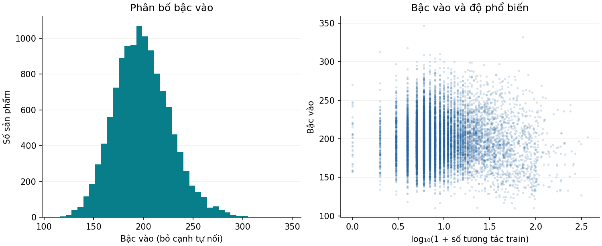

# RQ3 — Hubness và cộng đồng trên đồ thị giải mã RPG

Đồ thị kNN có hướng cho biết những sản phẩm nào xuất hiện thường xuyên trong danh sách láng giềng. Louvain và modularity đo cấu trúc cộng đồng trên phiên bản vô hướng của cùng đồ thị.

## Cách dựng đồ thị

Dùng checkpoint OPQ `main_s42` và semantic ID từ gói A bàn giao, ghép theo ASIN trên 12.101 sản phẩm của Beauty. Với mỗi vị trí mã, lấy cosine giữa hai vector token học được trong checkpoint và đưa về [0, 1]. Điểm giữa hai sản phẩm là trung bình qua 32 vị trí. Cấu hình Beauty thực tế giữ 200 ứng viên mỗi item, theo `n_edges` trong `hparams.yml` của `main_s42`. [Mã dựng đồ thị RPG tại commit 7dcf95c](https://github.com/facebookresearch/RPG_KDD2025/blob/7dcf95ce9e08601810efdd1c850ed6dada5f97c2/genrec/models/RPG/model.py#L144-L227)

Bỏ 12.101 cạnh tự nối khi tính bậc vào và không có cạnh tới đỉnh đệm. Còn 2.408.099 cạnh có hướng. Độ phổ biến là số lần item xuất hiện trong lịch sử train, tính cả lượt mua lặp. Nhóm phổ biến gồm 20% catalog có tần suất train cao nhất. [Cấu hình phân tích](../configs/graph_hubness.yaml) · [Kết quả JSON và checksum đầu vào](graph_hubness.json)

Đối chiếu trên CPU với hai hàm dựng đồ thị của RPG tại commit đã pin. Cả 2.420.200 vị trí trong adjacency của các item thật đều khớp, kể cả thứ tự ứng viên trong mỗi hàng.

## Bậc vào và độ phổ biến

| Trung bình | Độ lệch chuẩn | Skewness | Nhỏ nhất | Trung vị | P95 | P99 | Lớn nhất |
|---:|---:|---:|---:|---:|---:|---:|---:|
| 199 | 28,14 | 0,365 | 110 | 197 | 248 | 274 | 347 |

Phân bố lệch phải. Hub dẫn đầu có 347 cạnh vào, gấp 1,74 lần trung bình, và xuất hiện 5 lần trong train. Chỉ 5 trong 20 hub thuộc nhóm phổ biến. Tương quan Spearman giữa bậc vào và số tương tác train gần 0 (ρ = 0,0015, p = 0,870). Với checkpoint này, độ phổ biến trong train hầu như không dự báo bậc vào. Để biết hub có được gợi ý quá mức hay không, cần đối chiếu thêm với tần suất xuất hiện trong top-10 của RPG. [Danh sách 20 hub](graph_hubness.json)

## Cộng đồng Louvain

Nối vô hướng hai item nếu có cạnh theo ít nhất một hướng. Đồ thị không trọng số có 1.305.638 cạnh. Louvain seed 42 tìm được 7 cộng đồng, từ 207 đến 3.421 item, với modularity **0,120**.

| Nhãn danh mục chính | NMI | AMI |
|---|---:|---:|
| Danh mục lá | 0,221 | 0,208 |
| Danh mục cấp 3 | 0,224 | 0,221 |

Cộng đồng khớp một phần với danh mục sản phẩm. Dùng quy ước chọn đường danh mục chính của RQ1 để đối chiếu trên cùng nhãn. Các kết quả trên đo cấu trúc của checkpoint seed 42. [Quy tắc gán nhãn](../src/cluster_metrics.py)
