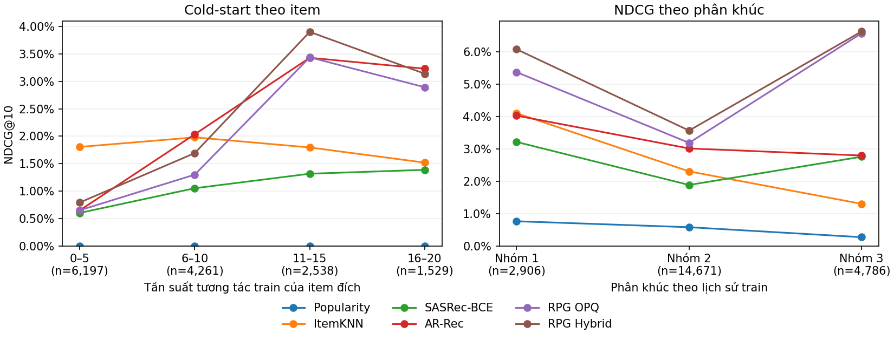
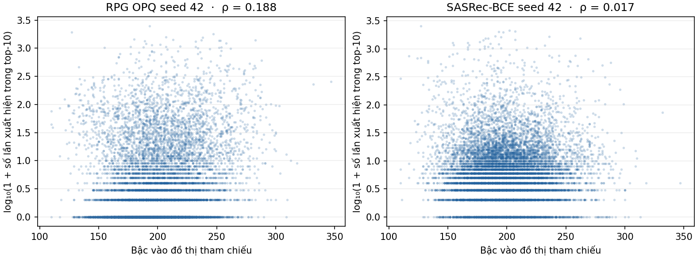

# RQ4 — Đánh giá mở rộng trên Amazon Beauty

Các độ đo hệ gợi ý mô tả độ chính xác, độ phủ catalog, độ đa dạng và kết quả theo nhóm. Phân khúc người dùng dùng k-means trên hành vi train. Cùng một split test leave-last-out có 22.363 user và 12.101 item cho mọi mô hình. Xếp hạng giữ item đã xem. [Kết quả JSON và checksum](rq4_analysis.json) · [Định nghĩa các độ đo](../docs/evaluation.md)

## Bảng so sánh chung

Với SASRec và RPG, lấy trung bình metric của ba seed 42–44. Coverage là trung bình độ phủ của từng seed. NDCG@10 ghi độ lệch chuẩn mẫu khi có nhiều seed. AR-Rec dùng cấu hình đã chọn trên validation (max_len 2, min_support 0,0001, min_confidence 0,05). [Kết quả chọn cấu hình AR-Rec](ar_rec_sweep.md)

| Mô hình | Recall@5 | Recall@10 | NDCG@5 | NDCG@10 | Coverage@10 | Long-tail@10 | Đa dạng danh mục@10 |
|---|---:|---:|---:|---:|---:|---:|---:|
| Popularity | 0,00720 | 0,01145 | 0,00398 | 0,00535 | 0,08% | 0,00% | 0,933 |
| ItemKNN | 0,02661 | 0,04440 | 0,01743 | 0,02322 | **98,38%** | **72,48%** | 0,890 |
| SASRec-BCE | 0,02975 | 0,05192 | 0,01535 | 0,02243 ± 0,00025 | 91,41% | 26,86% | 0,890 |
| AR-Rec | 0,03568 | 0,05621 | 0,02440 | 0,03097 | 23,54% | 12,33% | 0,873 |
| RPG OPQ | 0,04929 | 0,07277 | 0,03438 | 0,04194 ± 0,00184 | 41,58% | 16,30% | 0,825 |
| RPG Hybrid | **0,05405** | **0,07946** | **0,03727** | **0,04548 ± 0,00084** | 54,09% | 20,30% | 0,808 |

Hybrid tăng **8,42% NDCG@10**, phủ thêm **12,51 điểm phần trăm** catalog và tăng **4,00 điểm phần trăm** long-tail so với OPQ. Đa dạng danh mục trong mỗi danh sách giảm từ 0,825 xuống 0,808. Popularity luôn đề xuất cùng 10 item nên có thể có đa dạng nội danh sách cao dù coverage thấp.

### Kiểm định theo user

Lấy trung bình NDCG@10 qua các seed của từng mô hình cho từng user, sau đó chạy paired t-test hai phía trên 22.363 cặp. Mỗi chênh lệch là điểm mô hình trừ điểm OPQ. Bảng ghi p-value chưa hiệu chỉnh.

| Mô hình so với OPQ | Δ NDCG@10 | t | p-value |
|---|---:|---:|---:|
| Popularity | −0,03660 | −34,52 | 1,61 × 10⁻²⁵⁴ |
| ItemKNN | −0,01873 | −18,04 | 3,10 × 10⁻⁷² |
| SASRec-BCE | −0,01952 | −21,94 | 1,42 × 10⁻¹⁰⁵ |
| AR-Rec | −0,01097 | −10,32 | 6,25 × 10⁻²⁵ |
| **RPG Hybrid** | **+0,00353** | **5,89** | **4,00 × 10⁻⁹** |

## Cold-start theo tần suất item đích

Chia nhóm theo số lần item đúng xuất hiện trong train. Bốn nhóm dưới đây có 14.525 user. 7.838 user còn lại có item đích xuất hiện hơn 20 lần trong train.

| Tần suất train | User | Popularity | ItemKNN | SASRec-BCE | AR-Rec | RPG OPQ | RPG Hybrid |
|---|---:|---:|---:|---:|---:|---:|---:|
| 0–5 | 6.197 | 0,00000 | **0,01805** | 0,00601 | 0,00647 | 0,00649 | 0,00790 |
| 6–10 | 4.261 | 0,00000 | 0,01980 | 0,01052 | **0,02036** | 0,01299 | 0,01692 |
| 11–15 | 2.538 | 0,00000 | 0,01796 | 0,01316 | 0,03433 | 0,03440 | **0,03904** |
| 16–20 | 1.529 | 0,00000 | 0,01519 | 0,01387 | **0,03233** | 0,02894 | 0,03141 |

Hybrid cao hơn OPQ ở cả bốn nhóm. ItemKNN dẫn đầu nhóm 0–5 và AR-Rec dẫn đầu hai nhóm 6–10, 16–20. Mức cải thiện tổng thể của hybrid vẫn để lại khoảng cách với baseline ở các nhóm này.

## Phân khúc người dùng

K-means tạo ba nhóm với seed 42 và 20 lần khởi tạo. Ba đặc trưng chỉ dùng train gồm log(1 + độ dài lịch sử), đa dạng danh mục theo khoảng cách Jaccard và tỉ lệ tương tác với item thuộc 20% catalog phổ biến nhất. Chuẩn hóa ba đặc trưng trước khi phân cụm. Không có user nào thiếu giá trị đa dạng. Số nhóm do phân tích chọn để trình bày hồ sơ, còn NDCG trên test chỉ dùng sau khi đã có nhóm.

| Nhóm | User | Lịch sử trung bình | Đa dạng danh mục train | Tỉ lệ item phổ biến |
|---|---:|---:|---:|---:|
| 1 — ngắn, ít đa dạng | 2.906 | 4,13 | 0,542 | 54,72% |
| 2 — ngắn, đa dạng | 14.671 | 4,35 | 0,969 | 52,67% |
| 3 — dài, thiên về item phổ biến | 4.786 | 16,29 | 0,933 | 68,25% |

| Nhóm | Popularity | ItemKNN | SASRec-BCE | AR-Rec | RPG OPQ | RPG Hybrid |
|---|---:|---:|---:|---:|---:|---:|
| 1 | 0,00760 | 0,04101 | 0,03213 | 0,04027 | 0,05372 | **0,06079** |
| 2 | 0,00577 | 0,02303 | 0,01883 | 0,03012 | 0,03185 | **0,03565** |
| 3 | 0,00269 | 0,01299 | 0,02756 | 0,02793 | 0,06573 | **0,06629** |

Hybrid tăng NDCG@10 nhiều nhất ở nhóm 1 (+0,00707). Nhóm 2 chiếm **65,60%** số user và có NDCG@10 thấp nhất trong ba nhóm với cả OPQ và hybrid. Ở nhóm 3, mức tăng từ OPQ sang hybrid chỉ khoảng 0,00056.



## Bổ sung RQ3 — Hub trong top-10

Dùng đồ thị OPQ seed 42 để tính bậc vào, bỏ cạnh tự nối. Với mỗi sản phẩm, đếm số lần xuất hiện trong 223.630 vị trí top-10 test của từng mô hình. Spearman tính trên toàn catalog, gồm cả item không xuất hiện. Hai hàng dùng chung 20 hub có bậc vào cao nhất, chiếm 0,165% catalog.

| Ranking seed 42 | Spearman ρ | p-value | Lần xuất hiện của 20 hub | Tỉ lệ vị trí top-10 |
|---|---:|---:|---:|---:|
| RPG OPQ | 0,188 | 1,11 × 10⁻⁹⁶ | 964 | 0,431% |
| SASRec-BCE | 0,017 | 0,0644 | 465 | 0,208% |

Trong lượt OPQ seed 42, 20 hub chiếm tỉ lệ vị trí top-10 cao hơn mức 0,165% của chúng trong catalog khoảng 2,61 lần. SASRec seed 42 có tỉ lệ thấp hơn với cùng tập hub. Đây là đối chiếu quan sát ở một seed. Để xem tác động của đồ thị, cần chấm lại cùng checkpoint với đồ thị thay đổi.



## Tái lập

Đặt ranking và kết quả của bộ chấm chung theo [cấu hình phân tích](../configs/rq4_analysis.yaml). Tệp `adjacency.npy` lấy từ lượt dựng đồ thị OPQ seed 42 ở RQ3. Với AR-Rec, chạy cấu hình đã chọn và chấm như sau.

```bash
python -m src.ar_rec --split test --min-support 0.0001 --min-confidence 0.05 --max-len 2 \
  --ks 5 10 --output-dir experiments/rq4/ar_rec/test
python -m src.evaluate --rankings experiments/rq4/ar_rec/test/rankings.jsonl --model-name ar_rec \
  --split test --ks 5 10 --output-dir experiments/rq4/ar_rec/test
python -m scripts.analyze_rq4 --output reports/rq4_analysis.json --figures-dir reports/figures
```
